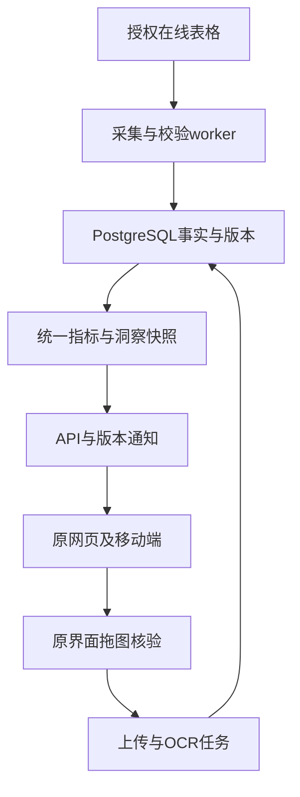

# 自托管共享数据架构

## 存储与服务

主库选**院方服务器上的PostgreSQL 17**，不依赖GitHub数据库、不使用飞书或外部托管数据库。上传原图与源文件放同机受控磁盘目录（例如`/srv/hospital-data/uploads`），库里记录SHA256、访问权限、来源及任务ID。仅授权API可读取；不置于public静态目录。数据库仅对API/worker网络开放，不对浏览器开放。外部依赖只保留现有WPS读取；OCR优先院内CPU worker，模型与语言包落盘固定版本，无强制云OCR。

应用按现有Next服务端约定新增`lib/server/operations/`与`app/api/operations/`，独立worker做采集/OCR/聚合。现有患者/任务系统分阶段接入，禁止顺手重写全部`lib/server/db.ts`而破坏其他模块。部署需固定镜像版本与摘要、迁移版本、依赖锁文件。此提交未提供已运行的Docker/API/worker，不得把下列目标当现成命令。

## 在线表格自动化

1. 分享链接不是读表API。先用官方文档确认个人文档/企业文档、传统表格/在线表格/多维表类型，适用的授权、文件ID、sheet ID与读取范围。优先官方授权API/导出能力。浏览器已登录仅证明可交互读取，不等于服务器长期授权。
2. 若账号确实无适用API，可部署院方授权的持久浏览器采集进程，按允许的页面操作导出。明确标记`browser_export`，记录登录有效性、重试与人工重新登录提示；禁止隐藏接口猜测、验证码绕过、承诺永久免登录。没有任一路径通过测试，该源必须`blocked`。
3. 拟定每5分钟轮询，加0—30秒抖动；源未变无需解析。改动元数据不可靠时比较完整允许范围的内容哈希。源限流时指数退避（1/2/5/15分钟），`Retry-After`优先；每源互斥锁、防止重叠采集。60秒任务心跳、超时租约回收。
4. 全量首次导入；以后以原生row ID为主定位变化。没有稳定row ID时，记录ID迁移策略：不把行号或姓名单独当身份；规范化业务键＋重复序号＋历史匹配。无法稳定匹配时进入人工核验，不随意合并两条真实业务。
5. 修订与删除同样重要：全量对比仅在完整授权范围读取成功、分页齐全、无异常空表时生成删除候选；部分导出、网络错误、表头漂移不得删库。删除以新修订/tombstone留痕。重算受影响的历史日、周、月及同比/环比依赖，不只追加“今天”。
6. 表头变动、单位、sheet移位、公式错误、缓存公式滞后进入隔离区；保留最后正确快照和明确过期提示。一次抓取成功不等于所有部门最新。

目标SLO（待上线实测）：源可访问且数据格式有效时，95%的表格变动在10分钟内发布；上传确认提交后在线客户端30秒内更新。不是未经验证的现状承诺。来源正常读取但无人新填报，要分别显示“抓取正常”和“业务数据停在某日”。

## 图片跨设备共享

原整页拖放/上传按钮/粘贴/核验表格保留。流程：POST上传→服务器持久文件与任务→OCR候选→原弹窗可修改→校验→确认提交事务→新revision→所有客户端刷新。OCR进行中或候选预览都不能算入正式营收。

- 幂等键由用户请求ID与文件SHA256控制。同图重复上传只回既有任务；不同图覆盖同日数据须展示字段差异。确认使用`expectedRevision`乐观锁，过期返回409并重核，不以最后提交静默覆盖。
- 校验门诊＋在院＝日合计、累计连续性、日期/单位/人数。金额按分整数；允许负向更正但须有来源与原因，不取绝对值。缺失字段不默认为0。
- 事实与来源修订、聚合快照、审计、outbox事件同一数据库事务提交。服务器成功返回revision才显示成功。取消/失败不发布，不影响已有快照。
- OCR失败保留原图和可手工核验入口，不能捏造识别结果。不把原图送外部LLM；如未来启用外部服务需另行配置和授权。
- 原“恢复初始数据/回退”保留入口，语义改为共享更正：展示影响、核验权限、生成补偿revision；不能清浏览器缓存就宣称全端回退。个人清缓存独立，不触碰共享事实。
- 旧localStorage仅作可恢复草稿；首次升级提示“本机未同步记录”，人工核验后通过同一确认接口迁移，禁止默默覆盖服务器。IndexedDB如用也仅缓存/草稿。

## 发布、刷新与可靠性

快照不可变，`publication_head`原子指向最新完整revision。所有组件从一份快照渲染，避免卡片来自A版本、榜单来自B版本。API事务读取头指针和快照，ETag为revision＋权限范围＋期间。事件只含版本/受影响指标，不含医疗信息。

持久outbox为可靠通知来源，SSE只是传输；PostgreSQL LISTEN/NOTIFY可用于唤醒，但不是持久消息队列。SSE重连带Last-Event-ID，补取遗漏；每30秒GET快照兜底、页面重新聚焦立即复核版本。慢响应不得覆盖较新revision。没有更新时304。页面隐藏可降频，回到前台立即同步。API异常保留最后正确数据，显示最后成功时刻，不播种假数据。

单源合格更新可发布一个新的全局快照，其他源保留旧值及各自watermark；跨源指标必须检查期间/口径/完整性，不能伪装同时更新。job进度、attempt、error、last_success、last_business_date分别记录，健康状态必须由真实心跳计算。

生产同源反向代理推荐：原站静态资源＋`/api/operations`→院方API，TLS、院内账号登录、角色权限、CSRF、防越权与审计。若原主机不能代理，只能配置明确允许的API origin与凭证策略；公网静态站直连内网API不可达时不能通过改前端实现。禁止为方便而将数据库端口暴露公网。无服务器托管临时磁盘不可用于主库/原图。

每天pg_dump＋文件增量备份到院方另一块受控存储；保留策略由院方确定。目标RPO≤24小时、RTO≤4小时须通过恢复演练证明。无备份恢复记录不算上线完成。迁移事务化、编号不可重复；回滚应用保留事实与新版本，不直接删生产表。

## 官方依据与接入边界

- WPS调用与权限：https://open.wps.cn/documents/app-integration-dev/wps365/server/api-description/flow 、https://open.wps.cn/documents/app-integration-dev/guide/permission 。必须现场验证账号文档类型和权限，不预设所有分享链接适用同一接口。
- 金山文档接口分类：https://developer.kdocs.cn/server/guide/api.html 、https://developer.kdocs.cn/server/guide/api-overview.html 。仅作接入选型依据，不能当这些文档已获API授权的证据。
- PostgreSQL通知：https://www.postgresql.org/docs/17/sql-notify.html 。可靠重放仍依赖outbox。
